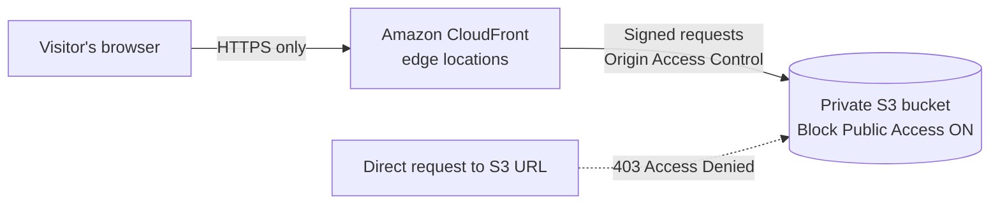

# Secure Static Website on AWS (S3 + CloudFront)

A static website hosted in a **private** Amazon S3 bucket and served through **Amazon CloudFront**. Visitors can only reach the content through CloudFront over HTTPS. The bucket itself is never public.

📝 Full write-up on Medium: [Setting up a static website using S3 and CloudFront](https://medium.com/@nathanielwang/setting-up-a-static-website-using-s3-and-cloudfront-dd719d2afbb8)

## Architecture



## Security design

| Decision | Why |
|---|---|
| **S3 Block Public Access left ON** | The bucket is never exposed directly to the internet. |
| **Origin Access Control (OAC)** | Only this CloudFront distribution can read objects from the bucket. OAC is AWS's current recommended method and replaces the older Origin Access Identity (OAI). |
| **Least-privilege bucket policy** | The policy allows only `s3:GetObject`, only for this bucket, and only when the request comes from this specific CloudFront distribution. See [`policies/s3-bucket-policy.json`](policies/s3-bucket-policy.json). |
| **HTTPS-only viewer protocol** | CloudFront redirects HTTP to HTTPS, so traffic is always encrypted in transit. |
| **No static website hosting endpoint** | S3's website endpoint only supports HTTP and needs a public bucket, so it isn't used. CloudFront serves the site instead. |

## How it was built

1. **Created the S3 bucket** with Block Public Access enabled, and uploaded the site files (`index.html`, `error.html`).
2. **Created a CloudFront distribution** with the S3 bucket as its origin, using **Origin Access Control**.
3. **Set the default root object** to `index.html`.
4. **Set the viewer protocol policy** to *Redirect HTTP to HTTPS*.
5. **Applied the bucket policy** that CloudFront generates for OAC (template in [`policies/`](policies/)), so only this distribution can read the bucket.
6. **Tested access:**
   - The CloudFront URL loads the site over HTTPS in multiple browsers.
   - Plain HTTP redirects to HTTPS.
   - The direct S3 object URL returns **403 Access Denied**, confirming the bucket is private.

## Repository contents

```
├── README.md
├── policies/
│   └── s3-bucket-policy.json   # OAC bucket policy (placeholders instead of real IDs)
└── site/
    ├── index.html              # Sample home page
    └── error.html              # Sample error page
```

> Account IDs, bucket names, and distribution IDs are replaced with placeholders like `<ACCOUNT_ID>`.

## What I'd add next

- A custom domain with an AWS Certificate Manager (ACM) certificate and Route 53
- Security headers (HSTS, Content-Security-Policy) through a CloudFront response headers policy
- Infrastructure as code (CloudFormation or Terraform) so the whole setup can be rebuilt in one step
- A GitHub Actions workflow that uploads site changes to S3 and invalidates the CloudFront cache

## Skills demonstrated

AWS S3 · CloudFront · IAM resource policies · Origin Access Control · TLS/HTTPS · least privilege · testing and verification
