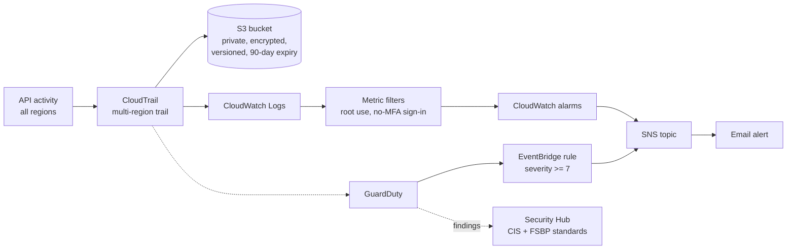

# AWS Security Monitoring Lab (Terraform)

Turns on core AWS security monitoring for an account with one `terraform apply`:

- **CloudTrail** records every API call, in every region, to an encrypted private S3 bucket
- **GuardDuty** watches for threats such as compromised credentials, crypto-mining, and unusual API activity
- **Security Hub** scores the account against the **CIS AWS Foundations Benchmark** and **AWS Foundational Security Best Practices**
- **Email alerts** fire when the root account is used, when a user signs in without MFA, or when GuardDuty reports a high-severity finding

> **Status:** Terraform is written, formatted, and validated in CI. Deployment results and screenshots will be added after it's applied to a lab account. See [Results](#results).

## Architecture



## Security design

| Control | How it's implemented | Why |
|---|---|---|
| Complete audit trail | Multi-region trail including global services (IAM, STS) | Attackers often act in regions nobody watches |
| Log integrity | `enable_log_file_validation` | Detects deleted or altered log files |
| Private log storage | S3 Block Public Access, AES-256 encryption, versioning | Logs contain sensitive account activity |
| Least-privilege bucket policy | Only this trail (`aws:SourceArn`) can write; non-HTTPS access denied | Prevents other services or accounts from writing to the bucket |
| Least-privilege IAM role | CloudTrail can only create streams and put events in its own log group | Limits damage if the role were misused |
| Root account alert | CIS benchmark metric filter on `userIdentity.type = "Root"` | The root account should almost never be used |
| No-MFA sign-in alert | CIS metric filter on `ConsoleLogin` with `MFAUsed != "Yes"` | Catches accounts that bypass MFA |
| Threat alerts | EventBridge forwards GuardDuty findings of severity 7.0+ | High-severity threats reach a person within minutes |

## Files

| File | Contents |
|---|---|
| `versions.tf` | Terraform and AWS provider versions, default tags |
| `variables.tf` | Region, name prefix, alert email, log retention |
| `cloudtrail.tf` | S3 bucket and policy, CloudWatch log group, IAM role, the trail |
| `detection.tf` | GuardDuty and Security Hub with the CIS and FSBP standards |
| `alerts.tf` | SNS topic, metric filters, alarms, GuardDuty EventBridge rule |
| `outputs.tf` | Bucket, log group, detector ID, alert topic |

## Deploy

**Prerequisites:** an AWS account you control (ideally a separate lab account), the AWS CLI configured with admin credentials, and Terraform 1.5 or later.

```bash
cd aws/security-monitoring
cp terraform.tfvars.example terraform.tfvars   # set alert_email
terraform init
terraform plan
terraform apply
```

Then **confirm the SNS subscription email** AWS sends you, or you won't receive alerts.

### Test the alerts

- **GuardDuty:** generate sample findings with `aws guardduty create-sample-findings --detector-id <id>`. High-severity samples arrive by email within minutes.
- **Security Hub:** after a few hours, review the CIS and FSBP scores in the console and note the top failed controls.
- **Root alert:** sign in once as root, then sign out. The alarm fires within about 5–10 minutes.

## Cost and cleanup

- **GuardDuty** and **Security Hub** each have a **30-day free trial**, then charge based on usage.
- The first CloudTrail management-events trail is free. S3 and CloudWatch Logs costs are small at lab scale.
- Remove everything when you're done:

```bash
terraform destroy
```

## Results

_To be added after deployment:_

- [ ] Screenshot: CloudTrail trail and S3 log delivery
- [ ] Screenshot: GuardDuty sample findings and the alert email
- [ ] Security Hub CIS and FSBP scores, with the top failed controls and how they would be fixed
- [ ] Root-login alarm firing
